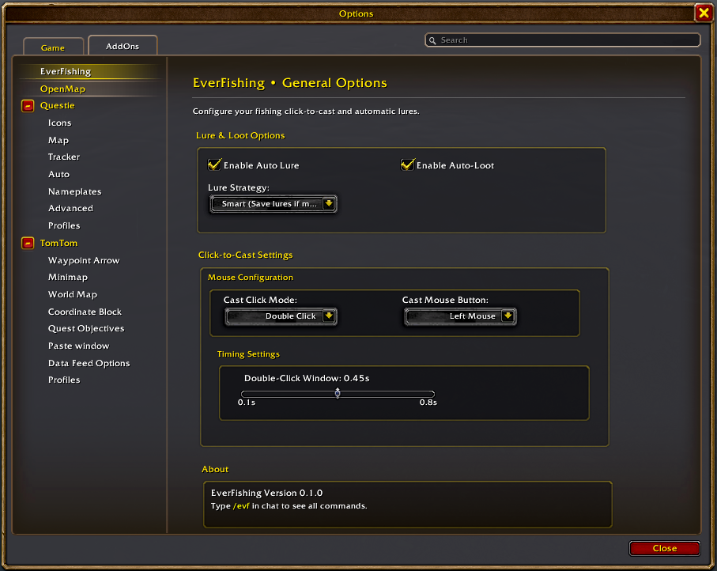

# EverFishing

  

**EverFishing** is a lightweight, fully-featured fishing companion for World of Warcraft — Retail, Classic, and Forever. It removes the friction from fishing by handling casting, luring, and looting automatically, letting you focus on your chat or your favorite podcast.

## Features

* **Click-to-Cast:** Configure your mouse to cast the fishing line exactly how you want it.
  * Choose between Left, Right, Middle, Mouse 4, or Mouse 5.
  * Toggle between Single-Click or Double-Click casting.
  * Adjustable double-click detection window (0.1s to 0.8s).
* **Smart Auto-Lure:** Never waste gold on lures again.
  * **Smart Strategy (Default):** If you are at max fishing skill, EverFishing will *not* apply a lure to save you money. If you aren't maxed, it will use your weakest eligible lures first.
  * **Weakest First:** Always uses the lowest-tier lure available.
  * **Strongest First:** Always uses the highest-tier lure available.
* **Auto-Loot:** Automatically loots the fish and closes the loot window instantly so you can cast again immediately.
* **Questie-Style Interface:** A native-looking options panel integrated directly into the game's AddOns menu.
* **Safety First:** Automatically pauses casting if you are in combat, moving, or if the loot window is open.

## Screenshots



## Installation

1. Download the latest release from the [Releases](https://github.com/kenny-gordon/WoW-EverFishing/releases/latest) page.
2. Extract the `EverFishing` folder into the `Interface/AddOns` directory of the client you play:

   ```text
   World of Warcraft\_retail_\Interface\AddOns\       (Retail)
   World of Warcraft\_classic_era_\Interface\AddOns\  (Classic Era)
   World of Warcraft\<forever-folder>\Interface\AddOns\ (Forever)
   ```

Use whichever folder your Forever installation uses.

3. Restart the game or type `/reload` in chat.
4. Ensure “EverFishing” is checked in your AddOn List on the character selection screen.

## Configuration

You can access the settings in two ways:

1. Retail & Forever: press `Esc` → **Options** → **AddOns** tab → click **EverFishing**.

2. Classic Era: press `Esc` → **Interface** → **AddOns** tab → click **EverFishing**.

Alternatively, type `/evf options` in chat on any client.

## Slash Commands

Type `/evf` or `/everfishing` followed by any of the commands below.

| Command | Description |
| --- | --- |
| `/evf status` | Shows your current settings, readiness state, and eligible lures. |
| `/evf button <left\|right\|middle\|4\|5>` | Sets the mouse button used to cast. |
| `/evf mode <single\|double>` | Sets whether you need to single or double-click to cast. |
| `/evf delay <0.1-0.8>` | Sets the double-click window timer in seconds. |
| `/evf lure <on\|off>` | Toggles automatic lure application on or off. |
| `/evf strategy <smart\|weakest\|strongest>` | Changes the lure selection logic. |
| `/evf loot <on\|off>` | Toggles automatic looting on or off. |
| `/evf pause` | Pauses casting (useful when interacting with a quest item). |
| `/evf resume` | Resumes casting after a pause. |

## License

This project is licensed under the **MIT License**.

You are free to use, copy, modify, merge, publish, and distribute this software. Please see the [LICENSE](LICENSE.txt) file for more details.

## Author

**Ken Gordon**

* Version: 0.1.1

* Feel free to open an issue or submit a pull request if you have suggestions or find bugs.
